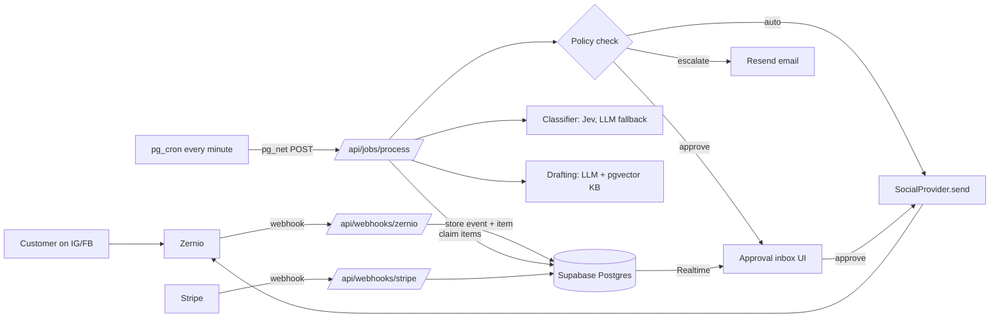

# TDD: AI Receptionist MVP (Pass 1)

Status: Draft v1 · Companion to `docs/prd.md` · Last updated: 2026-10-28

Items marked **VERIFY** must be checked against the live docs (Zernio, Jev) before implementing.

## 1. Architecture



Principle: **webhooks write, jobs process, the UI decides.** The webhook route only verifies, dedupes and stores (must answer 2xx within 5 seconds). All AI work and sending happens in the job route.

## 2. Stack

| Layer                             | Choice                                                              |
| --------------------------------- | ------------------------------------------------------------------- |
| App + API                         | Next.js (App Router) + TypeScript (strict), Tailwind, shadcn/ui     |
| Hosting                           | Vercel (Pro)                                                        |
| DB, auth, realtime, vectors, cron | Supabase (Pro): Postgres, Auth, Realtime, pgvector, pg_cron, pg_net |
| Social                            | Zernio Node SDK (`@zernio/node`) behind `SocialProvider`            |
| Triage                            | Jev (TypeSafe AI) behind `Classifier`, LLM fallback                 |
| Drafting + embeddings             | OpenRouter via Vercel AI SDK (`@openrouter/ai-sdk-provider`)        |
| Email                             | Resend                                                              |
| Errors                            | Sentry                                                              |
| Billing                           | Stripe                                                              |
| Validation                        | zod                                                                 |
| Tests                             | Vitest                                                              |

## 3. Folder structure

```
src/
├── app/                      # routes only, thin
│   ├── (auth)/
│   ├── (dashboard)/          # inbox, posts, knowledge base, settings, billing
│   └── api/
│       ├── webhooks/zernio/route.ts
│       ├── webhooks/stripe/route.ts
│       └── jobs/process/route.ts
├── features/
│   ├── tenants/              # signup, tenant + Zernio profile
│   ├── accounts/             # connect, health, disconnect handling
│   ├── publishing/           # compose, schedule, post status
│   ├── inbox/                # inbound items, status machine, event mapping
│   ├── triage/               # classification orchestration
│   ├── drafting/             # prompts, draft generation
│   ├── approvals/            # approval inbox, autonomy settings, policy check
│   ├── knowledge-base/       # CRUD, embeddings, retrieval
│   ├── leads/
│   ├── alerts/               # Resend emails
│   └── billing/              # Stripe checkout, gating
├── lib/
│   ├── social/               # SocialProvider interface + zernio adapter
│   ├── classifier/           # Classifier interface + jev + llm adapters
│   ├── llm/                  # AI SDK client, usage recording
│   ├── supabase/             # server/client/service-role clients
│   ├── jobs/                 # enqueue, claim, retry helpers
│   └── audit/
└── components/ui/            # shadcn
supabase/
├── migrations/
└── seed.sql
```

Rules: features expose a public API via `index.ts` and never import another feature's internals. Code moves to `lib/` only when a second feature needs it.

## 4. Multi-tenancy

- One `tenant` per business; one Zernio **profile** per tenant with `externalId = tenant.id`.
- Zernio webhooks carry `profiles[0].externalId`, so routing an event to a tenant needs no lookup.
- On profile creation, a `409 profile_external_id_conflict` means it already exists: use `details.existingProfileId`. Send an `Idempotency-Key` too (same key + body replays the original 201).
- Profile **names** are also unique per team and a duplicate name returns a 409 with `existingProfileId` too, but that profile may belong to another tenant: the adapter only adopts the existing profile for `profile_external_id_conflict`. T3 must make names unique (e.g. business name + short tenant id).
- Never pass a tenant an account ID that isn't in their profile (`POST /v1/posts` accepts any account in our team).
- Every tenant table has `tenant_id` and RLS.

## 5. Data model

All tables: `id uuid pk default gen_random_uuid()`, `created_at timestamptz default now()` unless noted.

| Table               | Key columns                                                                                                                                                                                                                                                                                         |
| ------------------- | --------------------------------------------------------------------------------------------------------------------------------------------------------------------------------------------------------------------------------------------------------------------------------------------------- |
| `tenants`           | name, zernio_profile_id (unique), stripe_customer_id, subscription_status (`trialing`/`active`/`past_due`/`canceled`), confidence_threshold (default 0.85)                                                                                                                                          |
| `tenant_members`    | tenant_id, user_id (auth.users), role (`owner`)                                                                                                                                                                                                                                                     |
| `social_accounts`   | tenant_id, zernio_account_id (unique), platform, username, status (`active`/`disconnected`/`error`)                                                                                                                                                                                                 |
| `posts`             | tenant_id, content, media (jsonb), target_account_ids (uuid[]), scheduled_for, status (`draft`/`scheduled`/`published`/`partial`/`failed`/`cancelled`), zernio_post_id, idempotency_key (unique), last_error                                                                                        |
| `webhook_events`    | **id text pk** (Zernio event id), source (`zernio`/`stripe`), event_type, payload jsonb, received_at, processed_at, error                                                                                                                                                                           |
| `conversations`     | tenant_id, social_account_id, zernio_conversation_id (unique), platform, participant_name, participant_external_id, last_customer_message_at                                                                                                                                                        |
| `inbound_items`     | tenant_id, social_account_id, kind (`comment`/`dm`), zernio_message_id or zernio_comment_id (unique per kind), zernio_post_id, conversation_id, author_name, text, received_at, **status**, category, confidence, classifier_used (`jev`/`llm`), attempts (int), next_run_at, locked_at, last_error |
| `drafts`            | tenant_id, item_id, body, edited_body, model, kb_entry_ids (uuid[]), status (`pending`/`approved`/`rejected`/`sent`/`failed`), decided_by, decided_at, sent_at, zernio_reply_id, idempotency_key (unique)                                                                                           |
| `kb_entries`        | tenant_id, title, content, embedding vector(N), updated_at. N = embedding model's dimension                                                                                                                                                                                                         |
| `autonomy_settings` | tenant_id, category, mode (`off`/`approve`/`auto`); pk (tenant_id, category)                                                                                                                                                                                                                        |
| `leads`             | tenant_id, item_id, name, contact, request                                                                                                                                                                                                                                                          |
| `audit_log`         | tenant_id, item_id, action, actor (`system` or user id), details jsonb                                                                                                                                                                                                                              |
| `ai_usage`          | tenant_id, item_id, purpose (`classify`/`draft`/`embed`), provider, model, input_tokens, output_tokens, cost_usd                                                                                                                                                                                    |

Indexes: `inbound_items (status, next_run_at)`, `inbound_items (tenant_id, created_at desc)`, ivfflat or hnsw on `kb_entries.embedding`.

As built (T1, `supabase/migrations`):
- Enumerated values are `text` + `check` constraints (easy to extend in a migration).
- Child tables reference parents by `(id, tenant_id)` composite foreign keys, so no row can point at another tenant's row, even when written with the service role. `posts.target_account_ids` (a `uuid[]`) is checked by a trigger: every id must be a `social_accounts` row of the same tenant (§4).
- `inbound_items`: a check requires `zernio_comment_id` for comments and `zernio_message_id` + `conversation_id` for DMs; both ids are unique. Extra column `classifier_scores jsonb` (per-category scores, §9.3; never message text).
- `kb_entries.embedding` is an untyped `vector` for now; T8 picks the embedding model, sets `vector(N)` and adds the HNSW index.
- A `before update` trigger on `kb_entries` sets `embedding = null` whenever `title` or `content` changes, so an edited entry never keeps the embedding of its old text. Re-embedding (T8) picks up entries where `embedding is null`. Tested in `supabase/tests/database/kb_entries_embedding.test.sql`.
- `autonomy_settings` rows are created by an `after insert` trigger on `tenants` with the PRD F9 defaults.
- Helpers live in a `private` schema (not exposed by PostgREST).

## 6. Inbound item status machine

```
new ──classify──▶ classified ──draft──▶ drafted ──policy──▶ awaiting_approval ──approve──▶ sending ──▶ sent
  │                  │                        │                    │ reject ──▶ rejected
  │                  │ spam ──▶ ignored        │ auto ──▶ sending
  │                  │ complaint/unclear ──▶ escalated
  │                  │ mode=off ──▶ escalated  └ escalate (policy fails) ──▶ escalated
  └ tenant unpaid / account disconnected ──▶ paused (resumes to new when fixed)
any step: error ──▶ retry (attempts+1, next_run_at backoff) ──▶ after 3 attempts ──▶ failed + escalated
```

Transitions live in one module (`features/inbox/status.ts`) with a pure `nextStatus()` function. Nothing else writes `status` directly.

Added in T12: `sending → awaiting_approval` (the mode changed between an auto-approval and the send) and `sent → failed` (`delivery_failed`, from a `message.failed` webhook).

Added in the UI pass: `escalated → handled` and `failed → handled` (`handle`: the owner answered on the platform themselves, "Mark as handled"); `sending → awaiting_approval` is also used by Undo.

## 7. Flows

### 7.1 Webhook ingest (`/api/webhooks/zernio`)

1. Read the raw body; verify `X-Zernio-Signature` = hex HMAC-SHA256(raw body, `ZERNIO_WEBHOOK_SECRET`). Mismatch → 400.
2. `insert into webhook_events (id, ...) on conflict (id) do nothing`. If no row inserted, return 200 (duplicate).
3. Map the event (fast, no external calls):
   - `comment.received` / `message.received` → upsert conversation (DMs), insert `inbound_items` with status `new`.
   - `post.*` → update `posts.status`.
   - `account.connected` / `account.disconnected` → upsert `social_accounts`; on disconnect set its open items to `paused` and enqueue an alert.
4. Return 200. Target well under 5 seconds; Zernio retries up to 7 times on failure.

Subscribe only to: `comment.received`, `message.received`, `message.failed`, `post.published`, `post.partial`, `post.failed`, `post.cancelled` (T14), `account.connected`, `account.disconnected`.

Confirmed (T2, docs.zernio.com/webhooks and the `@zernio/node` 0.2.1369 types `WebhookPayloadComment` / `WebhookPayloadMessage`):

- Signature: `X-Zernio-Signature` = lowercase hex HMAC-SHA256 of the raw body, no timestamp or prefix. Other headers: `X-Zernio-Event` (event name), `X-Zernio-Event-Id` (= payload `id`, stable across retries: the dedupe key).
- Delivery: at least once; 2xx within 5 s; up to 7 attempts (immediate, 10 s, 1 m 40 s, 16 m 40 s, 2 h 46 m 40 s, 24 h, 24 h), then dead-letter. The account lives at `account.accountId` (`account.id` is the same value).
- Redelivery (from Zernio's delivery log) re-sends the same event id to the endpoint's **current** URL, so a delivery that failed because of a wrong URL can be fixed and redelivered (observed 2026-10-28). The `X-Zernio-Signature` uses the secret configured on the endpoint; a mismatch with `ZERNIO_WEBHOOK_SECRET` returns 400 on every delivery, test events included.
- `comment.received`: `id`, `profiles`, `comment { id, postId (Zernio id, null for posts not published through Zernio), platformPostId, platform, text, author { id, username?, name?, isOwnAccount? }, createdAt, isReply, parentCommentId }`, `post { id, platformPostId, content, imageUrl, permalink }`, `account { id, accountId, platform, username }`, `timestamp`. Meta re-delivers our own replies as comments: **skip `author.isOwnAccount = true`** (T5).
- `message.received`: `message { id, conversationId, platform, platformMessageId, direction, text (nullable), attachments[], sender { id, name?, username? } }`, plus `account`. Only `direction = 'incoming'` creates items.

As built (T5): `src/app/api/webhooks/zernio/route.ts` → `features/inbox` (`receiveZernioEvent`). Decisions:

- **Responses:** bad or missing signature → 400 (nothing stored); valid signature but not JSON / no `id` → 400; mapping error → 500 (Zernio retries); everything else → 200 with the outcome (`processed`, `duplicate`, `skipped` + reason, `rejected` + reason). Missing `ZERNIO_WEBHOOK_SECRET` → 500.
- **Dedupe:** `webhook_events` insert `on conflict (id) do nothing`. Seen before and `processed_at` set → `duplicate`. Seen before but not processed (an earlier attempt failed) → mapped again; mapping is idempotent (unique `zernio_comment_id` / `zernio_message_id` / `zernio_conversation_id`), so a redelivery under a new event id also creates nothing new. A failure stores `webhook_events.error` and returns 500.
- **Tenant guard (all mapped events):** `profiles[0].externalId` must be an existing tenant **and** `profiles[0].id` must equal that tenant's `zernio_profile_id`. Otherwise `webhook_events.error = 'unknown_tenant'`, `processed_at` set, 200, nothing created. `account.*` events also require `account.profileId` to match (`profile_mismatch`).
- **Unknown account** on a comment/DM of a verified tenant: the account is upserted from the event's `account` block (same path as `account.connected`, so a username match reuses an existing row). A Zernio account or conversation id that belongs to another tenant → rejected (`foreign_account` / `foreign_conversation`), nothing attached.
- **Skips (stored, processed, no rows):** `test: true` events, `author.isOwnAccount = true` comments, outgoing messages, platforms other than Instagram/Facebook, `message.failed` (the send step handles it in T12), posts without a row here, unsubscribed event types.
- **Mapping:** comment → `inbound_items` (`zernio_post_id = comment.platformPostId`, `author_name = author.username ?? name`, `received_at = createdAt`). DM → conversation upsert (participant from `sender`, `last_customer_message_at` only moves forward, from `message.sentAt`) + item; attachment-only DMs get empty text. New items write `item_received` (ids only). `post.published/partial/failed` → `posts.status` and `last_error` (per-platform errors) + `post_status_changed`. `account.*` → T4 handlers.
- **Invalid payload** for a subscribed event (zod fails) → `rejected: invalid_payload`, reported to Sentry by event id.
- **Fixtures:** `tests/fixtures/zernio/*.json` follow the SDK payload types; they are not live captures yet (replace in T18). `pnpm test:integration` replays them through the real route against local Supabase.

### 7.2 Job processing (`/api/jobs/process`)

- `pg_cron` runs every minute and calls the route via `pg_net` with header `Authorization: Bearer CRON_SECRET`.
- Claim a batch atomically:
  ```sql
  update inbound_items set locked_at = now()
  where id in (
    select id from inbound_items
    where status in ('new','classified','drafted','sending')
      and (next_run_at is null or next_run_at <= now())
      and (locked_at is null or locked_at < now() - interval '5 minutes')
    order by received_at
    limit 20
    for update skip locked)
  returning *;
  ```
- Run each item's next step, write the new status, clear `locked_at`.
- Same route also: nudges owners about drafts waiting > 30 min (one email), escalates DMs whose 24-hour window will close within 1 hour, and runs an hourly account health check (`getAllAccountsHealth`).
- Optional fast path: after inserting an item, the webhook route may trigger processing for that item without waiting for cron, but must still return within 5 seconds.

As built (T6):

- **Route:** `POST /api/jobs/process`, `Authorization: Bearer CRON_SECRET` (constant-time compare, else 401), `maxDuration = 60`. Cron fires every minute, so runs don't overlap.
- **Deadline budget** (`lib/jobs`): stop claiming after 45 s; start an item (or its next step) only if at least 20 s of the 60 s remain; claimed items that don't start are unlocked at once for the next tick. Each Zernio or LLM call in a step uses `ctx.callSignal()`: 20 s or the rest of the run, whichever is shorter (Jev keeps its 3 s). The 5-minute stale-lock window is unchanged.
- **Claim:** `public.claim_items(limit)` is the §7.2 query (batch 20) and also returns the account status. A non-active account's open items are paused instead of processed (§11 step 1; the billing check comes in T15).
- **Steps:** one per processing status (`new` → classify T7, `classified` → draft T9, `drafted` → policy T10, `sending` → send T12) in `features/inbox/steps.ts`. A step returns an event; `nextStatus()` (pure, `features/inbox/status.ts`) maps it, and `public.transition_item` applies it with its audit row. Until a step exists its items are left untouched. Steps run back to back within a run while time allows, keeping the lock, so a message reaches its draft in one run rather than one step per minute (PRD §7).
- **Retries (§14):** a failed step → `attempts + 1`, `last_error`, `next_run_at = now + 2^attempts min` (2, 4 min). The 3rd failed attempt → `failed` + an `escalated` audit row (`retries_exhausted`; the email is T13). That is 3 attempts in total (§14, tasks.md T6; `MAX_ATTEMPTS`). Attempts count per step: a successful step resets them. `RetryLaterError(seconds)` (429) reschedules without counting an attempt.
- **Cron:** `pg_cron` job `process-inbound-items` (`* * * * *`) calls `private.trigger_job_processing()`, which reads `job_process_url` and `cron_secret` from Supabase Vault and `net.http_post`s with a 65 s timeout (longer than the run, so pg_net never drops it). Without both secrets a tick does nothing. Local: `supabase/seed.sql` sets them to `http://host.docker.internal:3000/api/jobs/process` and `local-dev-cron-secret`. Each environment adds its own with `vault.create_secret`.
- **Per-tenant fairness (T6b):** `claim_items(p_limit, p_per_tenant = 5, p_statuses)` takes at most 5 due items per tenant per batch (oldest first within the tenant, then oldest first overall) and only statuses the runner has a step for, so items waiting for an unconfigured step don't take a tenant's slots. The runner claims batches until its deadline, so a backlog still drains (tested: a tenant with 100 due items and one with 1 are both processed in the same tick).
- **Health check (T16)**, `features/accounts/health.ts`: each tick checks up to 5 tenants whose `tenants.health_checked_at` is over an hour old with `GET /v1/accounts/health?profileId=…`. An active account with `needsReconnect` or `status: error` goes through the same path as `account.disconnected` (status `disconnected`, open items paused, audit with `disconnectionType: health_check` and the issues, and the T13 disconnect email); a non-active account that is healthy again goes through `account.connected` (active, items resume). Skipped while Zernio is paused; a 402 records the pause.
- **Comment backfill (T16)**: `social_accounts.backfill_from` is set on a connect or reconnect (24 h back), by a health recovery (same path), and for every active account when a Zernio pause ends (from `pausedAt`). The sweep lists the account's posts with comments since then (`GET /v1/inbox/comments`) and each post's comments (`GET /v1/inbox/comments/{postId}`), and inserts the customers' comments through `insertInboundItem` (unique platform comment id, the same id the webhook carries), skipping our own replies; then clears `backfill_from` and writes `inbox_backfilled`. **DMs are not backfilled**: the webhook's `message.id` is Zernio's internal id and the list endpoint's id is not confirmed to match, so a backfilled DM could become a second item and a second reply (VERIFY on the live session).
- Not yet in the route: nothing else. Draft nudges, DM-window escalation and alert delivery were added in T13 (below).

As built (T13, `features/alerts`, `features/leads`):

- **Outbox.** Migration `alerts` adds `public.alerts` (tenant_id, kind `escalation`/`lead`/`disconnect`/`draft_waiting`, item/account/lead ids, `details` with ids and reasons only, unique `dedupe_key`, status `pending`/`sent`/`logged`/`failed`, attempts, `next_attempt_at`). RLS on, no client grants. Rows are queued by triggers in the same transaction as the change, so no code path can skip one and each event is exactly one row: `inbound_items` status → `escalated` or `failed` (key `escalation:<item>`: complaints, unclear, not covered by the KB, mode off, DM window closed, failed and rejected sends, undelivered replies, retries exhausted); `leads` insert (`lead:<lead>`); `social_accounts` status `active` → not active (`disconnect:<account>:<txid>`, so every drop alerts once and a repeat update while down doesn't).
- **Nudge.** `public.enqueue_draft_nudges('30 minutes')` (job route): pending drafts of `awaiting_approval` items older than 30 min with `drafts.nudged_at` null are marked nudged and queued as one `draft_waiting` alert per tenant ("2 replies are waiting…"). Each draft is nudged once.
- **DM window.** `escalateClosingDmWindows` (`features/approvals/sweeps.ts`, job route): an `awaiting_approval` DM whose customer message is more than 23 h old → `escalated` (`policyReason: dm_window_closing`), which queues the escalation email while the owner can still reply on the platform. This follows §7.2 literally; the draft can no longer be approved in the app after that (see open questions).
- **Delivery** (`deliverPendingAlerts`, job route, after the item steps, until 10 s remain): due `pending` alerts (batch 20) are claimed by bumping `attempts` conditionally, composed (`compose.ts`, pure) and sent to every owner's auth email (admin API) with `Idempotency-Key` = alert id. Success → `sent` (or `logged`), `provider_id`, `alert_sent` audit. Failure → retry after 2^attempts min; the 5th failure, or a permanent problem (item/lead/account gone, no owner email) → `failed`, `alert_failed` audit, Sentry.
- **Mailer.** `createResendMailer` calls Resend's REST API directly (`POST https://api.resend.com/emails` `{ from, to, subject, text, html }`, `Authorization: Bearer`, `Idempotency-Key`, 24 h; response `{ id }`; checked against resend.com/docs). No SDK dependency. Without `RESEND_API_KEY` and `ALERT_FROM_EMAIL`, and always under Vitest, `logMailer` logs the alert id and recipient count (no addresses or content) and the alert is marked `logged`.
- **In-app notification center** (docs/design.md §5, migration `notifications`, `features/alerts/notification-*.tsx`): `public.notifications` (tenant_id, kind `lead` / `needs_you` / `account` / `replies_waiting` / `post_published` / `post_failed` / `auto_sent`, `needs_action`, item/account/post ids, details with ids and counts, unique `dedupe_key`, `read_at`) is filled by triggers in the same transaction as the event: every `alerts` insert (so each alert is both an email and a notification), post status changes (published = update; failed / partial / cancelled-with-a-reason = needs action), and drafts sent with no owner decision (auto-send), batched into one row per tenant per day ("5 replies sent automatically", made unread again by each new one). Owners read their own through RLS and may only set `read_at`. The bell (sidebar) shows a violet count of unread rows that need action; the panel (All / Needs you / Updates, grouped Today / Earlier) loads through Server Actions; opening an item anywhere marks its notifications read. Not in the Realtime publication (rule 15): the badge refreshes on navigation and every 30 s.
- **Content.** Escalation: who (author), where (platform + comment/DM), why (reason code → sentence), link to `/inbox/items/<id>`. Never the customer's message: it stays in the app. Lead: name, contact and request (the point of the email), link to the conversation. Disconnect: account, link to `/settings`. Nudge: count, link to `/inbox`.
- **Pages.** `/leads` lists leads newest first (name, request, contact, source, time) with "View conversation". The inbox (design v2) shows the selected item as its conversation: for a DM, every message in it and the sent replies, interleaved by time; the waiting draft as the composer at the bottom; a context panel with the customer, the lead and the activity (`features/approvals/conversation-data.ts`). `/inbox/items/[id]` (linked from alert emails and notifications) redirects to `/inbox?tab=…&item=<id>`. Both read through RLS.
- Tests: `tests/integration/alerts.test.ts` (fake mailer): one email per escalation, failed item, lead, disconnect (and again after a reconnect and new drop), one nudge for two old drafts, DM-window sweep, logged mode, retry then give up.

### 7.3 Approval

- UI subscribes to `drafts` (Realtime, filtered by tenant).
- Approve → `drafts.status = approved`, item → `sending`, processed on the next job tick (or immediately via server action calling the same send function).
- Edit → store `edited_body`, then approve. Reject → item `rejected`.

As built (T11, `features/approvals`):

- **Page** `/inbox` (first nav item; `/` redirects there). "Waiting for approval" lists `awaiting_approval` items oldest first: author, platform and kind, time, category and confidence, the original message, the draft in an editable textarea, the titles of the KB facts it was drafted from, and for DMs when the 24-hour window closes. "Needs you" lists `escalated` and `failed` items with why (not covered by the KB plus the reason, complaint, unclear); the owner replies on the platform. Read with the owner's client (RLS).
- **Actions:** one Server Action `decideDraft` (intent approve/reject). The tenant comes from the session (`getCurrentTenant`), and every lookup in `approveDraft` / `rejectDraft` is filtered by that tenant id, so another tenant's ids are `not_found`. Approve: if the textarea differs from the draft, `edited_body` is stored (trimmed, max 1000 characters, the Instagram DM limit) and `draft_edited` written; the draft becomes `approved` with `decided_by`/`decided_at` and `draft_approved` (`edited: true/false`); then the item `awaiting_approval → sending` (status_changed, `decidedBy`). Draft first, so a request that dies in between leaves the item waiting with an approved draft, and approving again completes it. Reject: item `→ rejected` first, then the draft `rejected` + `draft_rejected`. A second decision returns `already_decided`. Audit rows carry ids only, never the reply text.
- **UI pass (docs/design.md)**: `/inbox` is two-pane (list with dividers, selected row lavender; detail on the right; list → detail on phones) with tabs To approve / Needs you / Sent (spam hidden). The approval card has "Approve and send" (pill; spinner + "Sending" while the action runs), "Edit", "Don't reply" and the shortcuts A (approve), E (edit), J (next), ignored while typing. Approving holds the reply for an **8-second undo window** (`next_run_at = now + 8 s`, so the job runner can't take it earlier) and the card collapses into "Sent to [name] · time · Undo" (kept in a small client store so the Realtime refresh doesn't drop it). Undo (`undoApproval`) is refused once the send step has started (locked or `send_attempted_at` set) or the window is over. After the window the Server Action's `after()` sends that one reply through the normal send step (`claimItem` + `processDueItems`), so it doesn't wait for the next cron tick. "Needs you" shows why (reason code from the last status change), a danger box "Couldn't send" with the fix for send problems, "Copy reply" and "Mark as handled" (`markHandled`, new status `handled`, migration `item_handled_status`).
- **Realtime:** migration `approval_inbox_realtime` adds `drafts` and `inbound_items` to the `supabase_realtime` publication. The page's `InboxLive` client component subscribes to both tables filtered by `tenant_id` and calls `router.refresh()` (debounced 300 ms), so the server re-reads rows rather than trusting the payload. It sets the owner's access token on the Realtime connection before joining: a channel joined with the anon key gets nothing, because postgres_changes applies RLS. Tested: an owner's subscription receives their own new draft and never another tenant's, even unfiltered. Realtime registers postgres_changes listeners shortly *after* `SUBSCRIBED`; tests wait for its `system` confirmation.

### 7.4 Sending

- Comment: `SocialProvider.replyToComment` (Zernio `POST /v1/inbox/comments/{postId}` with `accountId`, `commentId`, `message`, header `Idempotency-Key = drafts.idempotency_key`). `postId` may be the Zernio post id or the platform post id; use the webhook's `comment.platformPostId`, which is set even for posts not published through Zernio. Response `data.commentId`.
- DM: `SocialProvider.sendDm` (Zernio `POST /v1/inbox/conversations/{conversationId}/messages` with `accountId`, `message`, header `Idempotency-Key = drafts.idempotency_key`).
- Before sending a DM, check `conversations.last_customer_message_at > now() - 24h`; otherwise escalate.
- Idempotency (confirmed for both sends): same key + same body within 24 h replays the original response; same key + different body → 422; key in flight → 409. Only 2xx responses are stored, so a failure releases the key.
- A Zernio `5xx`, timeout or network error on send is ambiguous (may have been delivered): list the conversation's messages (or the post's comments) to reconcile before retrying; Zernio warns an empty list is inconclusive. The adapter marks these errors `ambiguous: true`.
- `429` (T20): Zernio's multi-tenant guide says to wait for `Retry-After`; the SDK only surfaces `X-RateLimit-Reset` (`RateLimitError`). The adapter passes a per-call `fetch` (the SDK's client honours it, though its types don't declare it) to keep the raw response headers, and sets `retryAfterSeconds` from `Retry-After` (seconds or HTTP date), else `X-RateLimit-Reset`, else undefined (callers fall back: 60 s for sends). The same applies to `409` while an idempotency key is in flight.
- **`402 PAYMENT_REQUIRED` (T19):** Zernio has paused the whole team (every tenant, reads included). The adapter's `isPlatformPaused(error)` recognises it. The send step records it in `platform_state['zernio_pause']` (migration `platform_pause`, server-only), clears the attempt mark (nothing was delivered) and reschedules in 5 min without counting an attempt or escalating; while the pause is recorded, every send waits without calling Zernio. The job route (`handlePlatformPause`) emails the operator once per pause (`OPERATOR_ALERT_EMAIL`, logged if unset; Sentry event) and probes Zernio (`SocialProvider.ping`, list one profile) at most every 5 minutes; the first successful probe clears the pause and sending resumes. Owners are never emailed about it; the app shows them one banner (UI pass).

As built (T12, `features/approvals/send-step.ts`, the `sending` job step):

- **Policy again at send time (rule 6).** The step reloads the item, account, tenant, mode, conversation and the approved draft and runs `policy()`. `PolicyInput.draft.approvedByOwner` (the draft has `decided_by`) makes an approve-mode item `send` (`owner_approved`); auto mode is `auto_send` as before. Anything else does not send: `dm_window_closed` (the 24-hour check, measured at send time), an inactive account or tenant, mode `off` → `escalated` with the policy reason; `approve` (auto-approved, then the owner switched the category to approve) → back to `awaiting_approval` with the draft `pending` (new transition `sending → awaiting_approval`). No approved draft → `escalated` (`no_approved_draft`).
- **Send.** Comment → `replyToComment` (`postId` = the item's `zernio_post_id`, i.e. the webhook's `platformPostId`; `commentId`); DM → `sendDm` (the conversation's Zernio id). Message = `edited_body ?? body`; `Idempotency-Key` = `drafts.idempotency_key`; the abort signal is the job's per-call budget (20 s), replacing the SDK's 60 s. Success → draft `sent`, `sent_at`, `zernio_reply_id`, `reply_sent` audit (ids only) → item `sent`.
- **Reconcile before resending (rule 7).** Migration `draft_send_attempts` adds `drafts.send_attempted_at`, set just before the request leaves and cleared once the outcome is known. If it is still set when the step runs (the last attempt got a 5xx, timed out or crashed), the step first looks for the reply on the platform: DMs via `listConversationMessages` (an outgoing message with the same text, not older than the first attempt minus 5 min), comments via the new `SocialProvider.listCommentReplies` (`GET /v1/inbox/comments/{postId}?commentId=…`: the comment's replies; ours have `from.isOwner`). Found → recorded as sent (`reconciled: true`), no second request. Not found is inconclusive (Zernio's warning), so it resends with the **same** idempotency key: if the first request did go through, Zernio replays its response instead of posting again.
- **Errors.** `429` → `RetryLaterError(retryAfterSeconds from X-RateLimit-Reset, else 60 s)`: rescheduled, no attempt counted, attempt mark cleared (nothing was delivered). `409` (same key in flight) → retry in 30 s, mark kept. Other non-ambiguous errors (400/401/403/404/422) → draft `failed`, `send_failed` audit (status and code), item `escalated` at once: retrying won't help. Ambiguous errors (5xx, timeout, network) count as an attempt (§14 backoff); the third → `failed` + `escalated`.
- **`message.failed` webhook** (`features/inbox/ingest.ts`): the draft whose `zernio_reply_id` equals `message.platformMessageId` (the send response's `data.messageId` is the platform message id, per the SDK docs; `message.id` is also tried) → draft `failed`, item `sent → failed` (new event `delivery_failed`), `delivery_failed` audit with the platform error code and title only. Unknown id → `skipped: unknown_message`. Zernio documents `message.failed` for WhatsApp, SMS and RCS only, so it should not arrive for Instagram/Facebook today.
- **Mock mode.** `SOCIAL_PROVIDER_MODE=mock` swaps in `MockSocialProvider` (in-process, replays by idempotency key, lists its own sends for reconcile), which the integration tests use with scripted failures (`tests/integration/sending.test.ts`). The real adapter is covered by the fetch-stubbed unit tests.
- Not built: a fast path from the approve action. An approved reply goes out on the next cron tick (within a minute).

### 7.5 Publishing

- `SocialProvider.createPost({ content, mediaUrls, targets, publishAt, idempotencyKey })` → Zernio `POST /v1/posts`. Confirmed: `scheduledFor` (ISO 8601 with `Z`/offset) or `publishNow: true` (`publishAt = null`); `platforms: [{ platform, accountId }]`; media as `mediaItems: [{ url }]` (the SDK README's `mediaUrls` is outdated). Header `Idempotency-Key` (24 h; a retry returns the original post with 200, `409 idempotency_conflict` + `Retry-After` while the first is in flight). Separately, identical content to the same account within 24 h is rejected with 409 and `existingPostId`.
- Media: `POST /v1/media/presign { filename, contentType, size? }` → `{ uploadUrl, publicUrl }`; `PUT` the file to `uploadUrl`; pass `publicUrl` in `mediaItems`. Store the URLs in `posts.media`.
- Status comes from `post.*` webhooks, not from polling.

As built (T14, `features/publishing`, `/posts`):

- **Statuses** (migration `posts_publishing`): `queued` (saved, not yet accepted by Zernio) → `scheduled` / `publishing` (Zernio's answer) → `published` / `partial` / `failed` / `cancelled` (from webhooks). New columns: `platform_results` (per platform: status, URL, error), `published_at`, `failure_reason` (`zernio_paused`, `account_removed`), `attempts`, `next_attempt_at`.
- **Compose** (Server Action `composePost`): text (max 2,200), optional image (JPG/PNG/WebP, max 5 MB; `serverActions.bodySizeLimit` 6 MB), accounts (only the tenant's own, connected ones: Zernio accepts any account of the team), now or a local date/time sent as ISO (at least 5 minutes ahead). The image goes through `SocialProvider.uploadMedia` (presign, then a server-side PUT, so no browser CORS on the upload URL; VERIFY on the live session). The post is inserted `queued` and handed to Zernio at once (`publishPost`), so "Post now" is immediate; the outcome shows in place.
- **`publishPost`**: refuses targets that aren't the tenant's or aren't active (owner-facing fix in the error); `createPost` with the post's idempotency key, `publishAt` null for now or a time already past; 402 → platform pause (T19), stays `queued`; 429 / 409 `idempotency_conflict` → `next_attempt_at` from `Retry-After`; other 409 (same content to the same account within 24 h) and 4xx → `failed` with a plain-words reason; unclear errors retry up to 3 attempts (same key). The job route's `publishQueuedPosts` retries queued posts.
- **Webhooks**: `post.published/partial/failed/cancelled` (now subscribing to `post.cancelled` too) update status, `platform_results`, `published_at`. A `post.failed` while `platform_state` shows a Zernio pause, or whose error mentions payment/billing, gets `failure_reason = 'zernio_paused'` (VERIFY the real error text on a pause); `post.cancelled` gets `account_removed` (its only account was deleted after the disconnect grace period).
- **Owner actions**: cancel a scheduled post (`DELETE /v1/posts/{id}`, then `cancelled`); retry or reschedule a failed or cancelled-with-reason post with a **new** idempotency key (the old one would replay the failure).
- **Mock mode**: `MockSocialProvider` records posts, stores images under the OS temp dir (served by `/api/mock-media/[name]`, 404 unless mock mode), and the job route settles due mock posts as published (no webhooks locally).
- **Page (design v2, `posts-view.tsx`)**: a month calendar (`?month=YYYY-MM`, pure helpers in `calendar.ts`). Each post sits on the day it went out, else the day it's planned (`postDay`), as a chip: check = published, clock = scheduled, amber = needs a new time (`needsNewTime`: failed, partial, or cancelled with a reason). An amber line above the calendar links the first such post (`?post=<id>` opens it on the right with Post now / Pick a time). Clicking a day (`?day=YYYY-MM-DD`) preselects Schedule with that day in the composer, which is always on the right (Day + Time fields; the button reads "Schedule for Sun 9:00 AM"). `?view=list` keeps the text view. **Not built:** the Week view, and a per-tenant time zone: the calendar groups days in the server's time zone (like every time on the server-rendered pages), which matches the owner only when they're in the same zone. Needs a `tenants.time_zone` before the pilot.

### 7.6 Signup and connect

- Signup → create tenant + member → `POST /v1/profiles { name, externalId: tenant.id }` → store `zernio_profile_id`.
- As built (T3), `features/tenants`:
  - Supabase Auth email + password (`/signup`, `/login`, `/auth/confirm` for the confirmation link; `src/proxy.ts` refreshes the session cookie). Works with email confirmation on or off.
  - `public.create_owner_tenant(user_id, name)` (service role only) creates tenant + owner member + `tenant_created` audit row in one transaction, or returns the existing tenant. An advisory lock per user serializes concurrent calls; a partial unique index (`tenant_members (user_id) where role = 'owner'`) is the backstop: one tenant per owner in Pass 1.
  - `ensureZernioProfile` creates the profile named `<business name> (<first 8 hex of tenant id>)` with `externalId = tenant.id`, then links it with `update … where zernio_profile_id is null` and writes `zernio_profile_linked`. No `Idempotency-Key`: Zernio's externalId uniqueness already makes a retry return the same profile (409 → adopt), and a key would 422 if the name changed between attempts.
  - Signup, login and email confirmation all run the same idempotent setup, so a request that died half-way is completed on the next attempt. A Zernio failure doesn't block signup (tenant is created, error goes to Sentry); the profile is retried on the next login or connect.
  - Tests: pgTAP `owner_tenant.test.sql`; `pnpm test:integration` (local Supabase, fake Zernio) proves one tenant + one profile across repeated, concurrent and lost-response retries. The concurrent test can't force the race over HTTP (removing the lock and index still passed); the unique index is what the pgTAP test proves.
- Connect → `GET /v1/connect/{platform}?profileId=…&redirect_url=…` → redirect the browser to `authUrl`; the account arrives via `account.connected`.
- As built (T4), `features/accounts`:
  - Settings page lists the tenant's accounts (platform, username, status, read through RLS) with Connect Instagram / Connect Facebook, and Reconnect on a non-active account. The connect Server Action completes the Zernio profile if signup couldn't, gets the connect URL with `redirect_url = APP_URL/settings?connecting=<platform>`, writes `account_connect_started` and redirects. Back on settings, Zernio's `error` / `error_message` params show as a banner (`code_already_redeemed` counts as success).
  - `account.connected` → `public.upsert_connected_account` (service role, one transaction, locked per tenant): same Zernio id → `existing`; otherwise the same platform + username (case insensitive) in the tenant → `reconnected`, the row gets the new Zernio id (Zernio issues a new account id when an account is reconnected after its 1-hour grace period); otherwise `created`. A Zernio id that belongs to another tenant → `foreign`, nothing changes. The account is set `active`, an `account_connected` audit row is written (not for a repeat of an already-active account), and its `paused` items resume to `new`. The payload has no platform user id, so username is the only match key.
  - `account.disconnected` → account `disconnected`; its `new` / `classified` / `drafted` items → `paused` (awaiting_approval keeps its draft; T12's send step refuses a non-active account; sending and terminal states are untouched); `account_disconnected` audit row with Zernio's `disconnectionType` and `reason`. The owner email is T13.
  - Item status changes go through `features/inbox/status.ts` → `public.transition_account_items`, which updates the items and writes one `status_changed` audit row per item (`from`, `to`, `reason`) in a single statement.
  - Not used yet: Zernio's `reconnectAccountId` connect param (refreshes an existing account id in place); Reconnect currently starts a normal connect and relies on the username match.

## 8. Interfaces

As built in T2 (`src/lib/*/types.ts`, `src/lib/llm/client.ts`); each lib's `index.ts` exports the interfaces and a server-only default instance (`getSocialProvider()`, `getClassifier()`, `getLlmClient()`).

```ts
// lib/social/types.ts
export interface SocialProvider {
  // 409 profile_external_id_conflict → the existing profile, alreadyExisted: true
  createProfile(input: { name: string; externalId: string; idempotencyKey?: string }): Promise<{ profileId: string; alreadyExisted: boolean }>;
  getConnectUrl(input: { platform: "instagram" | "facebook"; profileId: string; redirectUrl: string }): Promise<{ authUrl: string }>;
  createPost(input: CreatePostInput): Promise<{ providerPostId: string; status: ProviderPostStatus }>;
  replyToComment(input: { accountId: string; postId: string; commentId: string; message: string; idempotencyKey: string }): Promise<{ providerReplyId: string }>;
  sendDm(input: { accountId: string; conversationId: string; message: string; idempotencyKey: string }): Promise<{ providerMessageId: string }>;
  listConversationMessages(input: { conversationId: string; accountId: string; limit?: number }): Promise<ProviderMessage[]>; // newest first
  listCommentReplies(input: { accountId: string; postId: string; commentId: string; limit?: number }): Promise<ProviderCommentReply[]>; // T12 reconcile
  getAccountsHealth(input: { profileId: string }): Promise<AccountHealth[]>;
}
export interface CreatePostInput {
  content: string;
  mediaUrls?: string[];
  targets: { platform: "instagram" | "facebook"; accountId: string }[];
  publishAt: Date | null; // null = publish now
  idempotencyKey: string;
}
// Every adapter error is a SocialProviderError { status?, code?, ambiguous, retryAfterSeconds? }.
// ambiguous = 5xx / timeout / network: the request may have taken effect, reconcile before retrying.
// Sends and lists take an optional `signal` (T12: the job's per-call budget).

// lib/classifier/types.ts
export type Category = "faq" | "lead" | "complaint" | "spam" | "unclear";
export interface Classification {
  category: Category;
  confidence: number;
  provider: "jev" | "llm";
  model: string;
  scores?: Partial<Record<Category, number>>; // raw Jev scores, never message text
  reason?: "no_match" | "low_confidence"; // set when unclear
  fallbackReason?: "timeout" | "network" | "http" | "invalid_output" | "error"; // set when the LLM fallback answered
}
export interface Classifier {
  classify(
    input: { tenantId: string; itemId?: string | null; text: string; kind: "comment" | "dm"; businessContext?: string },
    options?: { signal?: AbortSignal },
  ): Promise<Classification>;
}

// lib/llm/client.ts: every call writes one ai_usage row
export interface LlmClient {
  generateObject<T>(input: { purpose: "classify" | "draft"; schema: z.ZodType<T>; system: string; prompt: string; tenantId: string; itemId?: string | null; signal?: AbortSignal }): Promise<{ object: T; model: string }>;
  embed(input: { value: string; tenantId: string; itemId?: string | null; signal?: AbortSignal }): Promise<{ embedding: number[]; model: string }>;
}

// lib/audit
export function writeAudit(db: ServiceClient, entry: { tenantId: string; itemId?: string | null; action: string; actor: "system" | string; details?: Json }): Promise<void>; // throws on failure

// features/drafting
export interface DraftResult {
  reply: string;
  needsHuman: boolean; // true if the KB doesn't cover the question
  reason?: string;
  lead?: { name?: string; contact?: string; request?: string };
}

// lib/jobs
export function enqueue(itemId: string, opts?: { runAt?: Date }): Promise<void>; // sets next_run_at; Temporal can replace later
```

The classifier used in production is `FallbackClassifier(jev, llm)`: try Jev with a 3-second timeout (`JEV_TIMEOUT_MS`, §9.4); on error, timeout or invalid output, use the LLM classifier and record `classifier_used = 'llm'`.

Changes from the draft interfaces (T2): `replyToComment` takes an `idempotencyKey` (Zernio supports it, rule 7); `createProfile` reports `alreadyExisted`; `createPost` takes `targets` (Zernio needs the platform per account) and `publishAt: Date | null`; `classify` takes `tenantId`/`itemId` (for `ai_usage`) and an abort signal; `Classification` gained `model`, `reason` and `fallbackReason`.

## 9. Jev integration

Adapter: `lib/classifier/jev.ts`, behind `Classifier`, wrapped by `FallbackClassifier(jev, llm)` (§8). Only the adapter knows the wire format.

### 9.1 Wire format (confirmed)

Same body on every backend: local jevos (`feder-cr/jev`), TypeSafe cloud, and the hosted endpoint used by our `small-decision-model` test repo.

```http
POST {JEV_API_URL}
Authorization: Bearer {JEV_API_KEY}        # omitted if unset (local jevos without a key)
Content-Type: application/json

{ "model": "jev-latest",
  "state": { "business": "<businessContext>", "channel": "comment" | "dm", "customer_message": "<text>" },
  "questions": { "<key>": { "type": "noul", "instructions": "<yes/no question>" }, ... } }
```

```json
{
  "model": "jevos-v5 | jev-1.13.0",
  "answers": { "<key>": { "type": "noul", "noul": 0.97 } },
  "usage": { "input_tokens": 120, "output_tokens": 4 }
}
```

- `state` may be a string or an object; questions are answered in parallel and in isolation against the same state, so extra questions add tokens but little latency.
- `noul` = P(yes), 0 to 1. Answers are **independent**: they do not sum to 1, and several can be high at once.
- `JEV_API_URL` is the **full endpoint URL** (paths differ between backends):
  - local jevos: `http://127.0.0.1:8017/v1/systemone` (CPU, ~1 GB RAM, 28-130 ms native x64; ~2.6 s under emulation on Apple Silicon)
  - TypeSafe cloud: `https://api.typesafe.ai/v1/systemone` (70-500 ms end to end)
  - test-repo hosted: `https://jevtypesafeai.com/api/v1/decide` (latency not measured; the test repo uses a 30 s timeout)
- Errors (cloud): 400 (incl. `max_tokens_exceeded`), 401, 413 (>32 MiB), 415, 422 (validation), 429 rate limited, 529 overloaded. The test-repo host also returns 402 (no credits) and 403 (inactive account). jevos context is 8,192 tokens.
- Validate the response with zod: every asked key present, `type === "noul"`, `noul` finite in [0, 1]. Anything else counts as invalid output and falls back to the LLM.

### 9.2 Questions (yes/no only, one request)

`unclear` is never asked; it is the result when nothing else applies. Four questions per message, defined once in `lib/classifier/jev-questions.ts` (versioned; wording tuned in T7):

| Key         | Instructions (starting wording)                                                                                                            |
| ----------- | ------------------------------------------------------------------------------------------------------------------------------------------ |
| `complaint` | Is the customer unhappy, complaining, reporting a bad experience or a problem with the business, or asking for a refund?                   |
| `lead`      | Is the customer asking to make a booking or reservation, to place an order, for a price or quote for a specific order they want to make, or sharing their contact details so the business can contact them? |
| `faq`       | Is the customer asking a question that the business's own information could answer, such as hours, location, prices, services or policies? |
| `spam`      | Is this an unsolicited sales pitch, scam, promotion of another business, or something that has nothing to do with this business?           |

Lessons from the test repo, applied above:

- "Is this spam/junk?" wordings scored near zero; describe it as unsolicited pitches **or nothing to do with the business** (hence `business` in `state`).
- Short replies ("ok", "thanks", "hello") score high on the off-topic question: messages under `SPAM_MIN_WORDS` (4) can never be `spam`.
- Avoid wordings that overlap through negation ("not cancelling"); jevos-v4 ignored negation (fixed in v5, but keep wordings positive).

**Lead = purchase intent only** (2026-10-29, `JEV_QUESTIONS_VERSION` / `LLM_CLASSIFY_PROMPT_VERSION` `2026-10-29.1`): a booking or reservation request, placing an order, a price or quote for a specific order, or sharing contact details to be contacted. A general question about prices, the menu, stock or availability is `faq`. The starting wording ended "…or ask about availability or how to get started?", which matched "Do you have oat milk?", and lead outranks faq (§9.3). The LLM classifier's definition says the same. Labeled set on local jevos-v5 (`pnpm triage:report`): accuracy 38.9% → 49.1%; faq recall 11.4% → 48.6%; lead precision 30.4% → 87.5% (recall 81.6% → 55.3%); unclear recall 37.5% → 81.3%; complaint unchanged (55.3%); spam still ~0% (3.1%). Most remaining misses on jevos-v5 now land in `unclear` (they escalate rather than get a wrong reply). Not re-measured on jev-1.13 (paid).

### 9.3 Picking the category

Precedence (safest first): `complaint > lead > faq > spam`. A higher category wins any overlap: a price question with purchase intent is a lead; an angry price question is a complaint; a real request wrapped in junk is not spam.

1. `p[c]` = `noul` for each key. "Yes" means `p[c] >= YES` (0.5); spam needs `p.spam >= SPAM_YES` (0.85), because trashing a real customer is worse than escalating junk.
2. `category` = the highest-precedence category that is "yes". None → `unclear` (reason `no_match`).
3. `confidence` = `p[category] × Π (1 − p[h])` over the categories **above** it in precedence. This is the chance the winner is right _and_ nothing that would override it applies. Example: faq 0.95 with complaint 0.40 gives 0.95 × 0.60 = 0.57. A hint of complaint blocks auto-send even when it doesn't clear 0.5. Lower-precedence scores don't count, since they could never change the outcome.
4. `confidence < MIN_CONFIDENCE` (0.5) → `unclear` (reason `low_confidence`). This also covers "top two too close": a close higher-precedence competitor pulls confidence down.
5. For `unclear`, `confidence` = `1 − max(p)`.

The tenant threshold (default 0.85) is still applied by `policy()` step 4 (§11); the classifier only decides the label. Thresholds are code constants until T7 tunes them on fixtures. `Classification` gains an optional `scores: Partial<Record<Category, number>>`, stored in the `audit_log` details for tuning (never the message text).

### 9.4 Fallback, cost, config

- `FallbackClassifier` gives Jev `JEV_TIMEOUT_MS` (default 3000) via `AbortController`. On timeout, network error, non-2xx (incl. 429/529: don't wait for `Retry-After`) or invalid output, use the LLM classifier and record `classifier_used = 'llm'` plus the reason in `audit_log`. The LLM fallback returns the same `Classification` (zod-validated, same five categories).
- Every Jev call writes `ai_usage` (`purpose = 'classify'`, `provider = 'jev'`, `model` from the response, tokens from `usage`). Cost = input tokens × `JEV_COST_PER_MTOK_INPUT` / 1e6 (cloud: $0.042; output tokens are free; local jevos: 0).
- Env: `JEV_API_URL` (required), `JEV_API_KEY` (optional), `JEV_MODEL` (default `jev-latest`), `JEV_TIMEOUT_MS`, `JEV_COST_PER_MTOK_INPUT`.
- Privacy: with a hosted backend, customer text leaves our infra; it needs a DPA like Zernio's. Never log `state`.
- As built (T2): `FallbackClassifier` aborts the Jev request at the deadline and also races it, so a hung adapter can't hold the step. A caller abort is not a fallback (it propagates). If the LLM fails too, the error propagates and the job retries (§14). The LLM fallback (`lib/classifier/llm.ts`, prompt versioned) applies the same rules as `pickCategory`: confidence < `MIN_CONFIDENCE` → `unclear` (`low_confidence`, confidence `1 − c`), and messages under `SPAM_MIN_WORDS` are never spam. `pickCategory` treats a short message's spam score as 0, so it doesn't count towards `max(p)` either. Jev usage is recorded even when the answers fail validation (the tokens were spent).

### 9.5 Switching to TypeSafe cloud

- Config only: `JEV_API_URL=https://api.typesafe.ai/v1/systemone`, `JEV_API_KEY=<TypeSafe key>`, set `JEV_COST_PER_MTOK_INPUT`. The noul design above works unchanged.
- Optional upgrade, behind `JEV_QUESTION_MODE=noul|choice` (default `noul`): one `choice` question with `criteria` `{faq, lead, complaint, spam, other}` (`other` → `unclear`). The response gives `choice`, `probabilities` (sum to 1) and `confidence` = (p_max − 1/n)/(1 − 1/n). Keep the `complaint` noul in the same request (mixed types are allowed) so precedence still holds; confidence below `MIN_CONFIDENCE` → `unclear`. Adopt only if T7's fixture report shows it beats noul.
- Response `model` becomes a version string (e.g. `jev-1.13.0`); store it in `ai_usage.model` to track model changes.
- We keep plain `fetch` + zod rather than TypeSafe's JS SDK, so one adapter serves every backend.

### 9.6 Testing

- Unit: `pickCategory(scores)` is pure (precedence, thresholds, confidence, short-message rule); the adapter is tested with mocked HTTP (valid, invalid shape, 4xx/5xx, timeout).
- T7: a fixture set of ~50 real-looking messages per category; a local script reports Jev vs LLM accuracy, confusion and latency per backend before Jev is enabled in production.

**VERIFY** before production: which hosted endpoint we use (TypeSafe cloud vs `jevtypesafeai.com`), its pricing, rate limits and DPA; real latency against the 3 s timeout.

As built (T7):

- **Job step** (`features/triage/classify-step.ts`, the `new` step): classifies with the tenant name as `businessContext`; stores `category`, `confidence` (4 dp), `classifier_used` and `classifier_scores` (Jev's raw scores, null for the LLM); writes a `classifier_fallback` audit row (`reason`, `used`, `model`) when the LLM answered; the status_changed row carries category, confidence, classifier, model, unclear reason and fallback reason. The LLM call is capped by the job's 20 s `callSignal`; Jev keeps its 3 s inside `FallbackClassifier`. If both fail, the step errors and the item retries (§14).
- **Production classifier** (`getClassifier()`): `FallbackClassifier(jev, llm)` when both are configured, otherwise whichever is (Jev alone then has only the 20 s cap, not 3 s), otherwise none, and the job leaves `new` items alone instead of failing them.
- **Jev via OpenRouter** (`OpenRouterJevClassifier`, `typesafe/jev-1.13`, Decisions API alpha): the same four questions and `pickCategory()`, for comparison in the report only. It calls the provider model's `doEvaluate` directly: `ai` 7.0.155's `experimental_decide` passes `state` as typed parts, which `@openrouter/ai-sdk-provider` 3.1.0 forwards unchanged, so OpenRouter would receive `[{ type: "json", value }]`. Recheck when either package is upgraded.
- **Labeled set** (`tests/fixtures/triage/`): 30 messages per category plus 25 ambiguous cases (each with a note), English and Taglish, for the demo café. A starter set to review: about 35 per category, not the ~50 planned above.
- **Report** (`pnpm triage:report`, `scripts/triage-report.ts`): runs the configured classifiers directly (no fallback, 30 s timeout, concurrency 4): `jev` (`JEV_API_URL`) and extra Jev endpoints from `TRIAGE_JEV_ENDPOINTS=name=url,...` (key `JEV_API_KEY_<NAME>`) by default; `jev-openrouter` and `llm` (`OPENROUTER_API_KEY` + LLM config) only when named in `--only`, because they spend money or free-tier quota (rule 14). `--only` matches whole names (`jev` never selects `jev-openrouter`). Prints accuracy, recall and precision per category, the confusion matrix, accuracy by language and on the ambiguous set, p50/p95/max latency, total AI cost and the misclassified messages; `--json` writes everything. No DB writes.

## 10. LLM drafting

- Provider: **OpenRouter** through the Vercel AI SDK (`@openrouter/ai-sdk-provider` 3.x, AI SDK 7), so one balance covers every model. Models are OpenRouter `provider/model` ids set by env (`LLM_CLASSIFY_MODEL`, `LLM_DRAFT_MODEL`, `EMBEDDING_MODEL`).
- Provider resolution lives only in `lib/llm/provider.ts` (`LLM_PROVIDER`, `EMBEDDING_PROVIDER`; only `openrouter` today), so going direct to a provider later is config plus one case there.
- Structured output: AI SDK 7 `generateText` with `Output.object({ schema })` (zod schema matching `DraftResult`), wrapped by `LlmClient.generateObject`.
- Embeddings: OpenRouter's `/embeddings` endpoint natively (`openrouter.textEmbeddingModel`, e.g. `openai/text-embedding-3-small`); no `@ai-sdk/openai` needed.
- Cost: models are created with `usage: { include: true }`; `ai_usage.cost_usd` = `providerMetadata.openrouter.usage.cost` (USD, chat and embeddings), 0 when absent. `ai_usage.model` is the served model id from the response (fallback: the configured id); `provider = 'openrouter'`.
- A failed `ai_usage` insert is reported to Sentry by ids and does not fail the step (retrying would pay for the call again).
- Retrieval: embed the incoming text, fetch the top 5 `kb_entries` by cosine similarity for the tenant, pass them as the only source of facts.
- Prompt rules (system prompt, versioned in `features/drafting/prompts.ts`):
  - Answer only from the provided business info; if not covered, set `needsHuman = true` and write a short holding reply.
  - Never invent prices, availability, discounts, medical/legal advice or promises.
  - Match the business's tone setting; keep comment replies under 2 sentences and DMs under 4.
  - Public comments never ask for or repeat personal contact details; move those to DM.
- Record every call in `ai_usage`.

As built (T8, `features/knowledge-base`):

- **Model:** `openai/text-embedding-3-small` through OpenRouter, 1536 dimensions. `kb_entries.embedding` is `vector(1536)` with an HNSW index (`vector_cosine_ops`); `toVectorLiteral` rejects any other length, so changing `EMBEDDING_MODEL` to a model with another dimension fails loudly and needs a migration. Every embedding request sends `dimensions: 1536` (`EMBEDDING_DIMENSIONS`, `lib/llm/provider.ts`), so a model that can shorten its output also fits: for free local testing `nvidia/nemotron-3.5-embed-1b:free` (2048 natively) returns 1536 at $0 (checked 2026-10-29). Embeddings from different models are not comparable: re-embed the KB (clear `embedding`) after switching models.
- **Embedded text:** `title + "

" + content`.
- **On save:** owners create, edit and delete entries on `/knowledge-base` (Server Actions through RLS; `kb_entry_created/updated/deleted` audit rows with the owner as actor). The embedding is computed after the response (`after()`), with the service client, since the column isn't client-writable. The write is conditional on the `updated_at` that was read, so an embedding of old text never lands on newer text.
- **Re-embedding:** the job route runs `embedPendingEntries` each tick (when the LLM is configured and time remains): every entry whose `embedding is null` (new, edited via the T1 trigger, or a failed embed). Entries waiting for an embedding aren't retrievable (shown as "Indexing…").
- **Retrieval:** `retrieveKbEntries` embeds the message (`ai_usage` purpose `embed`, against the item) and calls `public.match_kb_entries(tenant, embedding, 5)`: service role only, one tenant, cosine similarity, best first, limit capped at 20.
As built (T9, `features/drafting`):

- **Step** (`classified` → `drafted`): first `triage()` (policy steps 1-4): spam → `ignored`; complaint, unclear, mode off or low confidence → `escalated`; unpaid or account down → `paused`. None of these call the LLM. A pending draft that already exists for the item (retry after a crash) is reused.
- **Draft:** `generateDraft` = top-5 retrieval → `LlmClient.generateObject` (`purpose: draft`, `LLM_DRAFT_MODEL`) with `draftOutputSchema` (nullable fields, so providers' strict structured-output modes accept it), mapped to `DraftResult`. The prompt (`DRAFT_PROMPT_VERSION`) has the §10 rules plus: reply in the customer's language (English or Taglish); at most one emoji, and only if the customer used them; leads are never confirmed by the receptionist; the customer message is fenced and treated as data. There is no tone setting yet (no column), so the tone is fixed: friendly, warm, professional.
- **Grounding check** (rule 8 safety net, `grounding.ts`): any amount (₱/PHP/$/pesos), percentage, email or phone number in the reply that isn't in the retrieved facts forces `needsHuman` (`ungrounded_amount`, `ungrounded_percentage`, `contact_details_not_in_kb`), so policy escalates it.
- **Stored:** `drafts` (body, model, `kb_entry_ids`, `needs_human`, `needs_human_reason`, status `pending`) + `draft_created` audit row (ids, model, prompt version, grounding issues; never text). For `lead` items, a `leads` row (name, contact, request when the customer gave them) once per item + `lead_captured`; the owner email is T13.
- **Demo business:** `supabase/demo_kb.sql` (loaded after `seed.sql` via `[db.seed] sql_paths`) makes the seeded tenant "Harbour Bean Café" with 15 entries (hours, location, menu and prices, cakes, catering, function room, reservations, payments, delivery, amenities, corkage, workshop, contact). It's the same shop as the triage set.
- **Preview:** `pnpm draft:preview` (`scripts/draft-preview.ts`) embeds the tenant's pending entries, then prints the draft (facts used, reply, needsHuman and reason, lead, latency) for each message in `tests/fixtures/drafting/samples.json` (15: covered, partly covered, uncovered, leads, a prompt injection), or for `--text`. No drafts, leads or ai_usage rows are written. Scripts run with `tsconfig.scripts.json`, which maps `server-only` to its empty module.

- **Tests:** `tests/integration/kb.test.ts` runs the real client → OpenRouter HTTP → pgvector path, with OpenRouter faked by a deterministic bag-of-words embedding (plumbing, ordering, tenant scoping, stale writes; not model quality).

## 11. Policy check (`features/approvals/policy.ts`, pure function)

Input: item, classification, draft, tenant, account, autonomy mode, now. Output: `'send' | 'approve' | 'escalate' | 'ignore'` + reason.

Order:

1. Tenant not active (billing) or account not active → `paused` (handled before drafting).
2. Category `spam` → `ignore`.
3. Mode `off`, category `complaint`/`unclear`, or `draft.needsHuman` → `escalate`.
4. Confidence < tenant threshold → `escalate` (treat as unclear).
5. DM outside 24-hour window → `escalate`.
6. Mode `approve` → `approve`.
7. Mode `auto` → `send`.

Fully unit-tested; no I/O.

As built (T10, `features/approvals`):

- `policy(input)` returns `{ decision: 'pause' | 'ignore' | 'escalate' | 'approve' | 'send', reason }` in the order above. Details: `trialing` counts as paying; confidence **equal** to the threshold passes; a DM with no known customer message, or exactly 24 h old, is outside the window; a missing draft counts as `needsHuman`; a missing autonomy row counts as `off`.
- `triage(input)` is steps 1-4 without the draft, returning `draft` when the item is worth drafting. The T9 draft step uses it, so the pre-draft rules live in one place.
- The `drafted` job step (`createPolicyStep`) loads the item, tenant, account, mode, latest pending draft and conversation window, runs `policy()`, and maps the decision to an event: send → `sending`, approve → `awaiting_approval`, escalate → `escalated`, ignore → `ignored`, pause → `paused`. In auto mode it also marks the draft `approved` (`decided_by` null = system) and writes `draft_auto_approved`. The decision, reason and mode go into the status_changed audit row.
- `drafts.needs_human` and `drafts.needs_human_reason` columns (migration `draft_needs_human`) carry `DraftResult.needsHuman`.
- Settings UI ("Reply autonomy"): a mode selector for **faq** and **lead** only. Complaints and unclear messages always escalate and spam is always ignored (steps 2-3), so those rows are shown as fixed rather than offering a setting that would do nothing. The Server Action updates `mode` through RLS and writes `autonomy_mode_changed` (from → to) with the owner as actor.

## 12. Billing

- Stripe Checkout for the subscription; webhook `/api/webhooks/stripe` verifies the signature and handles `checkout.session.completed`, `customer.subscription.updated`, `customer.subscription.deleted` → update `tenants.subscription_status`.
- Stripe events also go through `webhook_events` for dedupe.
- Gate: job processing skips tenants not `active`/`trialing` (items → `paused`).

## 13. Security

- RLS on every tenant table: `tenant_id in (select tenant_id from tenant_members where user_id = auth.uid())`. The membership lookup is `private.user_tenant_ids()` (security definer, so `tenant_members` policies don't recurse).
- Client (`authenticated`) access, enforced with RLS plus table/column grants:
  - **Read:** every tenant table, own tenants only (Realtime needs this for `drafts`).
  - **Write, owner-authored content only:** `tenants` (name, confidence_threshold), `kb_entries` (insert/update title and content, delete), `posts` (insert/update content, media, target accounts, schedule), `autonomy_settings` (mode).
  - **No client writes:** `inbound_items`, `drafts`, `conversations`, `social_accounts`, `leads`, `audit_log`, `ai_usage`, `tenant_members`. Server Actions and jobs write these with the service-role client after checking membership, so status changes (rule 5), sends and audit rows stay in server code.
  - `webhook_events`: no client access at all. `anon`: no access to any table.
- New tables get no client grants by default (default privileges revoked); each migration grants what it needs.
- `supabase/tests/database/rls.test.sql` (pgTAP, `pnpm test:db`) proves tenant A can't read or write tenant B's rows.
- **Realtime** (`postgres_changes` on `drafts` and `inbound_items`, the inbox page): authorized by RLS, not by the client's filter. For every change `realtime.apply_rls` applies the subscription's filters, switches to the subscriber's role and JWT claims and runs a prepared select of the row under RLS; only subscribers who can see the row get the event. Exception: **DELETE events skip the RLS check** (the row is gone) and went to every subscriber of the table (row id only, default replica identity). Migration `realtime_no_deletes` sets `supabase_realtime` to `publish = 'insert, update'` (publication-wide, so it covers tables added later; applied to the hosted project by `supabase db push`). `REPLICA IDENTITY FULL` on a tenant table would put whole old rows into such events: never use it. Guards: `tests/integration/realtime-isolation.test.ts` (tenant A's signed-in client, unfiltered and filtered to B's tenant id, receives none of B's inserts, updates or deletes and no DELETE event at all, while A's own draft arrives) and pgTAP `realtime_publication.test.sql` (no deletes published, published tables have RLS and no FULL replica identity, only the tested tables published). CLAUDE.md rule 15.
- Realtime clients must join with the user's token: `realtime.setAuth()` is async, and a join sent before it resolves is evaluated as `anon` (RLS then returns nothing, and filtered joins are refused with "invalid column for filter"). `InboxLive` awaits it. A freshly started local Realtime server can also refuse early joins; tests retry a refused join (never a delivered event).
- **Planned pattern for more live features** (e.g. a notification center): Realtime Broadcast on private per-tenant channels (topic per tenant, authorized by RLS policies on `realtime.messages`, messages sent by triggers or the server), rather than adding tables to the `postgres_changes` publication.
- Service-role key only in server code (`lib/supabase/service.ts`), never shipped to the client.
- Verify signatures on Zernio and Stripe webhooks; `CRON_SECRET` on the job route.
- Never log full webhook payloads to Sentry (customer messages); log ids.

## 14. Errors and retries

- Step failure → `attempts + 1`, `next_run_at = now() + 2^attempts minutes`, `last_error` set.
- After 3 attempts → `failed`, escalate to owner.
- External rate limits (429) → reschedule using `Retry-After`; don't count as an attempt.

## 15. Observability

- Sentry for errors (server and client).
- `audit_log` for every state change and owner action.
- `ai_usage` for cost per tenant; a simple admin query shows cost per message.

As built (T17):

- **Item activity** (`activityLines` in `features/approvals/conversation-data.ts`, in the inbox context panel): the item's `audit_log` rows as a few plain lines (received, recognized as a lead, reply written from <topics>, approved by you, sent, handed to you and why). Owners see outcomes only: no model names, tokens or costs; those stay on the operator's `/admin/costs` page.
- **Cost view** (`/admin/costs`, `features/billing`): operator only (`OPERATOR_EMAILS`, comma-separated; unset = any signed-in user in local development, nobody in production; others get a 404). Last 30 days per business: messages, replies sent, AI calls, AI cost, AI cost per message (`public.cost_by_tenant`, service role), the latest 50 messages with their AI calls and cost (`public.cost_by_item`), and Zernio's spend for the billing cycle per business from `SocialProvider.getUsageByProfile` (`GET /v1/usage?range=cycle&groupBy=profile`, `attribution.groups[].key` = profile id; `unattributed` shown separately). Mock mode has no Zernio usage, so that column shows "not available".

## 16. Testing

- **Unit (Vitest):** `nextStatus()`, `policy()`, signature verification, event mapping (with recorded webhook fixtures in `tests/fixtures/zernio/`), prompt output parsing.
- **Integration:** Supabase local; job route against seeded items with `SocialProvider` and `Classifier` mocked.
- **Manual smoke (staging):** a test Zernio profile with a test Instagram account; webhook endpoint scoped to that profile (`profileIds`) so test traffic never hits production.

### Demo mode (local)

`pnpm demo:seed` (`scripts/demo-seed.ts`, local Supabase only) refills the seeded demo tenant, Harbour Bean Café (`owner@example.com` / `password123`, `supabase/seed.sql`), and nothing else: Instagram and Facebook accounts, 14 messages through the real status transitions (4 waiting for approval incl. a lead, a held complaint, an unclear message, a question the business info doesn't cover, a DM whose 24-hour window closed before the approved reply went out, 4 sent replies incl. 2 auto-sent, a handled one, spam), 2 leads, 3 posts (published, scheduled, failed during a Zernio pause), the alerts and notifications those produce, and AI cost rows at illustrative production prices. The business info (`demo_kb.sql`) is kept. It sets a placeholder Zernio profile id so logging in never creates a real profile. With `SOCIAL_PROVIDER_MODE=mock` in `.env.local` the whole app can be clicked through with no external calls (approving a reply sends it through the mock; posts publish through the mock and settle on the next job tick).

## 17. Environment variables

```
NEXT_PUBLIC_SUPABASE_URL, NEXT_PUBLIC_SUPABASE_ANON_KEY, SUPABASE_SERVICE_ROLE_KEY
ZERNIO_API_KEY, ZERNIO_WEBHOOK_SECRET
JEV_API_URL, JEV_API_KEY, JEV_MODEL, JEV_TIMEOUT_MS, JEV_COST_PER_MTOK_INPUT
LLM_PROVIDER (openrouter), OPENROUTER_API_KEY, LLM_CLASSIFY_MODEL, LLM_DRAFT_MODEL
EMBEDDING_PROVIDER (openrouter), EMBEDDING_MODEL
RESEND_API_KEY, ALERT_FROM_EMAIL, OPERATOR_ALERT_EMAIL, OPERATOR_EMAILS
SOCIAL_PROVIDER_MODE (mock | zernio)
STRIPE_SECRET_KEY, STRIPE_WEBHOOK_SECRET, STRIPE_PRICE_ID
CRON_SECRET
SENTRY_DSN
APP_URL
```

`SENTRY_DSN` is also exposed to the browser as `NEXT_PUBLIC_SENTRY_DSN` through `next.config.ts` (a DSN is not secret), so there is one variable to set. Sentry drops request bodies and cookies and sends no default PII (`src/lib/sentry.ts`).

Setup notes (T0): Next.js 16 (Turbopack, `cacheComponents`), Tailwind 4, shadcn/ui `base-nova`, ESLint 9 flat config + Prettier, Vitest 5, `@sentry/nextjs` 11 (`withSentryConfig` is imported from `@sentry/nextjs/config`). `pnpm typecheck` runs `next typegen` first because route types such as `LayoutProps` are generated.

Setup notes (T2): `@zernio/node` 0.2.1369 (pinned: it publishes daily), `ai` 7.0.155, `@openrouter/ai-sdk-provider` 3.1.0, `@supabase/supabase-js` 2. DB types are generated into `src/lib/supabase/database.types.ts` by `pnpm gen:types` (rerun after each migration). `lib/*/index.ts` and `lib/supabase/service.ts` import `server-only`; Vitest aliases it to its empty module. Tests mock HTTP only: `fetch` is stubbed under the real Zernio SDK and passed to the OpenRouter provider and the Jev adapter.

## 18. Open technical questions

- Jev: production endpoint (TypeSafe cloud vs `jevtypesafeai.com`), pricing, rate limits, DPA and measured latency (shape confirmed, §9.1).
- Option to evaluate in T7: OpenRouter also serves Jev (`typesafe/jev-1.13`) through its Decisions API (`openrouter.evaluationModel()`, alpha). It would put Jev on the same balance; it is not used now because the shape is alpha and our adapter speaks the §9.1 wire format.
- Whether to add the webhook fast path in Pass 1 or rely on the 1-minute cron.
- **Zernio multi-tenant guide (docs.zernio.com/multi-tenant, compared 2026-10-29).** Followed: one profile per tenant with `externalId` = tenant id and 409 `profile_external_id_conflict` adoption (§7.6); connect via `GET /v1/connect/{platform}` with `profileId` + `redirect_url`; reconnect into the same profile, matching by username for the new account id after the grace period; tenant resolved from `profiles[0].externalId` + profile id; one key, server-side only. Tracked in tasks: per-tenant fairness (T6b), 402 handling (T19), `Retry-After` (T20), paused-post rescheduling and `post.cancelled` (T14), usage per profile (T17), health check (T16), offboarding (T21). Not followed or open:
  - **Team-wide blast radius.** Billing, the rate limit and API access belong to the Zernio team: a payment failure pauses every tenant at once (immediately without $50 of payment history, otherwise after a 24 h grace period), and a Terms suspension needs support. Billing tenants separately would need one Zernio account each. Decide the operator process (card on file, alerting) before launch.
  - **While paused, Zernio's inbox polling stops**, so comments and DMs that arrive then may never reach us by webhook; T16's backfill must also run after a pause.
  - **Scoped API keys** (`POST /v1/api-keys`, `scope: "profiles"`, `disabledResourceGroups`): not used. We call Zernio only from the server with one key; a key limited to the groups we use (publishing, engagement, messages, accounts, webhooks) would limit damage if it leaked. Consider one per environment.
  - **Disconnect from our side** (`DELETE /v1/accounts/{accountId}`; the 1-hour grace period keeps the account id and posts not yet due): no "Disconnect" button yet; only offboarding (T21) uses it.
  - **Posts accept any team account id**: enforced on our side by the `posts.target_account_ids` same-tenant trigger (§5); T14 must send only those accounts' Zernio ids.
  - **White-label connect** (`PUT /v1/connect/welcome-screen`, `welcome=true`, `headless=true`): not used; Meta's consent screen still names the Zernio app. Product decision.
  - **Connect links last 30 minutes**: the connect action fetches a fresh link on every click, so a stale tab is only an issue if the owner waits on Zernio's page; the error banner should say to try again.
  - **Lost profile id lookup** (`GET /v1/profiles?externalId=…`): we rely on the 409 adoption instead, which is equivalent.
  - **Costs not attributed to a profile** (credits, 10DLC, Verify) appear as `unattributed` in usage; T17 should show them separately rather than split them.
- DM window escalation (T13): §7.2 says to escalate waiting DMs an hour before the window closes, which takes the draft out of the approval inbox. An alternative is an urgent email that leaves the draft approvable until the window actually closes (the send step already escalates at 24 h).
