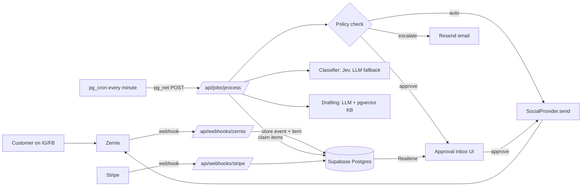

# TDD: AI Receptionist MVP (Pass 1)

Status: Draft v1 · Companion to `docs/prd.md` · Last updated: 2026-10-28

Items marked **VERIFY** must be checked against the live docs (Zernio, Jev) before implementing.

## 1. Architecture



Principle: **webhooks write, jobs process, the UI decides.** The webhook route only verifies, dedupes and stores (must answer 2xx within 5 seconds). All AI work and sending happens in the job route.

## 2. Stack

| Layer                             | Choice                                                              |
| --------------------------------- | ------------------------------------------------------------------- |
| App + API                         | Next.js (App Router) + TypeScript (strict), Tailwind, shadcn/ui     |
| Hosting                           | Vercel (Pro)                                                        |
| DB, auth, realtime, vectors, cron | Supabase (Pro): Postgres, Auth, Realtime, pgvector, pg_cron, pg_net |
| Social                            | Zernio Node SDK (`@zernio/node`) behind `SocialProvider`            |
| Triage                            | Jev (TypeSafe AI) behind `Classifier`, LLM fallback                 |
| Drafting + embeddings             | Direct provider API via Vercel AI SDK                               |
| Email                             | Resend                                                              |
| Errors                            | Sentry                                                              |
| Billing                           | Stripe                                                              |
| Validation                        | zod                                                                 |
| Tests                             | Vitest                                                              |

## 3. Folder structure

```
src/
├── app/                      # routes only, thin
│   ├── (auth)/
│   ├── (dashboard)/          # inbox, posts, knowledge base, settings, billing
│   └── api/
│       ├── webhooks/zernio/route.ts
│       ├── webhooks/stripe/route.ts
│       └── jobs/process/route.ts
├── features/
│   ├── tenants/              # signup, tenant + Zernio profile
│   ├── accounts/             # connect, health, disconnect handling
│   ├── publishing/           # compose, schedule, post status
│   ├── inbox/                # inbound items, status machine, event mapping
│   ├── triage/               # classification orchestration
│   ├── drafting/             # prompts, draft generation
│   ├── approvals/            # approval inbox, autonomy settings, policy check
│   ├── knowledge-base/       # CRUD, embeddings, retrieval
│   ├── leads/
│   ├── alerts/               # Resend emails
│   └── billing/              # Stripe checkout, gating
├── lib/
│   ├── social/               # SocialProvider interface + zernio adapter
│   ├── classifier/           # Classifier interface + jev + llm adapters
│   ├── llm/                  # AI SDK client, usage recording
│   ├── supabase/             # server/client/service-role clients
│   ├── jobs/                 # enqueue, claim, retry helpers
│   └── audit/
└── components/ui/            # shadcn
supabase/
├── migrations/
└── seed.sql
```

Rules: features expose a public API via `index.ts` and never import another feature's internals. Code moves to `lib/` only when a second feature needs it.

## 4. Multi-tenancy

- One `tenant` per business; one Zernio **profile** per tenant with `externalId = tenant.id`.
- Zernio webhooks carry `profiles[0].externalId`, so routing an event to a tenant needs no lookup.
- On profile creation, a `409 profile_external_id_conflict` means it already exists: use `details.existingProfileId`.
- Never pass a tenant an account ID that isn't in their profile (`POST /v1/posts` accepts any account in our team).
- Every tenant table has `tenant_id` and RLS.

## 5. Data model

All tables: `id uuid pk default gen_random_uuid()`, `created_at timestamptz default now()` unless noted.

| Table               | Key columns                                                                                                                                                                                                                                                                                         |
| ------------------- | --------------------------------------------------------------------------------------------------------------------------------------------------------------------------------------------------------------------------------------------------------------------------------------------------- |
| `tenants`           | name, zernio_profile_id (unique), stripe_customer_id, subscription_status (`trialing`/`active`/`past_due`/`canceled`), confidence_threshold (default 0.85)                                                                                                                                          |
| `tenant_members`    | tenant_id, user_id (auth.users), role (`owner`)                                                                                                                                                                                                                                                     |
| `social_accounts`   | tenant_id, zernio_account_id (unique), platform, username, status (`active`/`disconnected`/`error`)                                                                                                                                                                                                 |
| `posts`             | tenant_id, content, media (jsonb), target_account_ids (uuid[]), scheduled_for, status (`draft`/`scheduled`/`published`/`partial`/`failed`/`cancelled`), zernio_post_id, idempotency_key (unique), last_error                                                                                        |
| `webhook_events`    | **id text pk** (Zernio event id), source (`zernio`/`stripe`), event_type, payload jsonb, received_at, processed_at, error                                                                                                                                                                           |
| `conversations`     | tenant_id, social_account_id, zernio_conversation_id (unique), platform, participant_name, participant_external_id, last_customer_message_at                                                                                                                                                        |
| `inbound_items`     | tenant_id, social_account_id, kind (`comment`/`dm`), zernio_message_id or zernio_comment_id (unique per kind), zernio_post_id, conversation_id, author_name, text, received_at, **status**, category, confidence, classifier_used (`jev`/`llm`), attempts (int), next_run_at, locked_at, last_error |
| `drafts`            | tenant_id, item_id, body, edited_body, model, kb_entry_ids (uuid[]), status (`pending`/`approved`/`rejected`/`sent`/`failed`), decided_by, decided_at, sent_at, zernio_reply_id, idempotency_key (unique)                                                                                           |
| `kb_entries`        | tenant_id, title, content, embedding vector(N), updated_at. N = embedding model's dimension                                                                                                                                                                                                         |
| `autonomy_settings` | tenant_id, category, mode (`off`/`approve`/`auto`); pk (tenant_id, category)                                                                                                                                                                                                                        |
| `leads`             | tenant_id, item_id, name, contact, request                                                                                                                                                                                                                                                          |
| `audit_log`         | tenant_id, item_id, action, actor (`system` or user id), details jsonb                                                                                                                                                                                                                              |
| `ai_usage`          | tenant_id, item_id, purpose (`classify`/`draft`/`embed`), provider, model, input_tokens, output_tokens, cost_usd                                                                                                                                                                                    |

Indexes: `inbound_items (status, next_run_at)`, `inbound_items (tenant_id, created_at desc)`, ivfflat or hnsw on `kb_entries.embedding`.

As built (T1, `supabase/migrations`):
- Enumerated values are `text` + `check` constraints (easy to extend in a migration).
- Child tables reference parents by `(id, tenant_id)` composite foreign keys, so no row can point at another tenant's row, even when written with the service role. `posts.target_account_ids` (a `uuid[]`) is checked by a trigger: every id must be a `social_accounts` row of the same tenant (§4).
- `inbound_items`: a check requires `zernio_comment_id` for comments and `zernio_message_id` + `conversation_id` for DMs; both ids are unique. Extra column `classifier_scores jsonb` (per-category scores, §9.3; never message text).
- `kb_entries.embedding` is an untyped `vector` for now; T8 picks the embedding model, sets `vector(N)` and adds the HNSW index.
- A `before update` trigger on `kb_entries` sets `embedding = null` whenever `title` or `content` changes, so an edited entry never keeps the embedding of its old text. Re-embedding (T8) picks up entries where `embedding is null`. Tested in `supabase/tests/database/kb_entries_embedding.test.sql`.
- `autonomy_settings` rows are created by an `after insert` trigger on `tenants` with the PRD F9 defaults.
- Helpers live in a `private` schema (not exposed by PostgREST).

## 6. Inbound item status machine

```
new ──classify──▶ classified ──draft──▶ drafted ──policy──▶ awaiting_approval ──approve──▶ sending ──▶ sent
  │                  │                        │                    │ reject ──▶ rejected
  │                  │ spam ──▶ ignored        │ auto ──▶ sending
  │                  │ complaint/unclear ──▶ escalated
  │                  │ mode=off ──▶ escalated  └ escalate (policy fails) ──▶ escalated
  └ tenant unpaid / account disconnected ──▶ paused (resumes to new when fixed)
any step: error ──▶ retry (attempts+1, next_run_at backoff) ──▶ after 3 attempts ──▶ failed + escalated
```

Transitions live in one module (`features/inbox/status.ts`) with a pure `nextStatus()` function. Nothing else writes `status` directly.

## 7. Flows

### 7.1 Webhook ingest (`/api/webhooks/zernio`)

1. Read the raw body; verify `X-Zernio-Signature` = hex HMAC-SHA256(raw body, `ZERNIO_WEBHOOK_SECRET`). Mismatch → 400.
2. `insert into webhook_events (id, ...) on conflict (id) do nothing`. If no row inserted, return 200 (duplicate).
3. Map the event (fast, no external calls):
   - `comment.received` / `message.received` → upsert conversation (DMs), insert `inbound_items` with status `new`.
   - `post.*` → update `posts.status`.
   - `account.connected` / `account.disconnected` → upsert `social_accounts`; on disconnect set its open items to `paused` and enqueue an alert.
4. Return 200. Target well under 5 seconds; Zernio retries up to 7 times on failure.

Subscribe only to: `comment.received`, `message.received`, `message.failed`, `post.published`, `post.partial`, `post.failed`, `account.connected`, `account.disconnected`. **VERIFY** the exact `comment.received` payload fields (comment id, post id, author).

### 7.2 Job processing (`/api/jobs/process`)

- `pg_cron` runs every minute and calls the route via `pg_net` with header `Authorization: Bearer CRON_SECRET`.
- Claim a batch atomically:
  ```sql
  update inbound_items set locked_at = now()
  where id in (
    select id from inbound_items
    where status in ('new','classified','drafted','sending')
      and (next_run_at is null or next_run_at <= now())
      and (locked_at is null or locked_at < now() - interval '5 minutes')
    order by received_at
    limit 20
    for update skip locked)
  returning *;
  ```
- Run each item's next step, write the new status, clear `locked_at`.
- Same route also: nudges owners about drafts waiting > 30 min (one email), escalates DMs whose 24-hour window will close within 1 hour, and runs an hourly account health check (`getAllAccountsHealth`).
- Optional fast path: after inserting an item, the webhook route may trigger processing for that item without waiting for cron, but must still return within 5 seconds.

### 7.3 Approval

- UI subscribes to `drafts` (Realtime, filtered by tenant).
- Approve → `drafts.status = approved`, item → `sending`, processed on the next job tick (or immediately via server action calling the same send function).
- Edit → store `edited_body`, then approve. Reject → item `rejected`.

### 7.4 Sending

- Comment: `SocialProvider.replyToComment` (Zernio `POST /v1/inbox/comments/{postId}` with `accountId`, `commentId`, `message`).
- DM: `SocialProvider.sendDm` (Zernio `POST /v1/inbox/conversations/{conversationId}/messages` with `accountId`, `message`, header `Idempotency-Key = drafts.idempotency_key`).
- Before sending a DM, check `conversations.last_customer_message_at > now() - 24h`; otherwise escalate.
- A Zernio `500` on send is ambiguous (may have been delivered): list the conversation's messages to reconcile before retrying. `429` → respect `Retry-After`.

### 7.5 Publishing

- `SocialProvider.createPost({ content, mediaUrls, accountIds, publishAt | publishNow, idempotencyKey })` → Zernio `POST /v1/posts`. **VERIFY** the scheduling field name and idempotency header for posts.
- Media: upload per Zernio's media flow (**VERIFY**), store returned URLs in `posts.media`.
- Status comes from `post.*` webhooks, not from polling.

### 7.6 Signup and connect

- Signup → create tenant + member → `POST /v1/profiles { name, externalId: tenant.id }` → store `zernio_profile_id`.
- Connect → `GET /v1/connect/{platform}?profileId=…&redirect_url=…` → redirect the browser to `authUrl`; the account arrives via `account.connected`.

## 8. Interfaces

```ts
// lib/social/types.ts
export interface SocialProvider {
  createProfile(input: { name: string; externalId: string }): Promise<{ profileId: string }>;
  getConnectUrl(input: {
    platform: "instagram" | "facebook";
    profileId: string;
    redirectUrl: string;
  }): Promise<{ authUrl: string }>;
  createPost(input: CreatePostInput): Promise<{ providerPostId: string; status: string }>;
  replyToComment(input: {
    accountId: string;
    postId: string;
    commentId: string;
    message: string;
  }): Promise<{ providerReplyId: string }>;
  sendDm(input: {
    accountId: string;
    conversationId: string;
    message: string;
    idempotencyKey: string;
  }): Promise<{ providerMessageId: string }>;
  listConversationMessages(input: {
    conversationId: string;
    accountId: string;
  }): Promise<ProviderMessage[]>;
  getAccountsHealth(input: { profileId: string }): Promise<AccountHealth[]>;
}

// lib/classifier/types.ts
export type Category = "faq" | "lead" | "complaint" | "spam" | "unclear";
export interface Classification {
  category: Category;
  confidence: number;
  provider: "jev" | "llm";
  scores?: Partial<Record<Category, number>>;
}
export interface Classifier {
  classify(input: {
    text: string;
    kind: "comment" | "dm";
    businessContext?: string;
  }): Promise<Classification>;
}

// features/drafting
export interface DraftResult {
  reply: string;
  needsHuman: boolean; // true if the KB doesn't cover the question
  reason?: string;
  lead?: { name?: string; contact?: string; request?: string };
}

// lib/jobs
export function enqueue(itemId: string, opts?: { runAt?: Date }): Promise<void>; // sets next_run_at; Temporal can replace later
```

The classifier used in production is `FallbackClassifier(jev, llm)`: try Jev with a 3-second timeout (`JEV_TIMEOUT_MS`, §9.4); on error, timeout or invalid output, use the LLM classifier and record `classifier_used = 'llm'`.

## 9. Jev integration

Adapter: `lib/classifier/jev.ts`, behind `Classifier`, wrapped by `FallbackClassifier(jev, llm)` (§8). Only the adapter knows the wire format.

### 9.1 Wire format (confirmed)

Same body on every backend: local jevos (`feder-cr/jev`), TypeSafe cloud, and the hosted endpoint used by our `small-decision-model` test repo.

```http
POST {JEV_API_URL}
Authorization: Bearer {JEV_API_KEY}        # omitted if unset (local jevos without a key)
Content-Type: application/json

{ "model": "jev-latest",
  "state": { "business": "<businessContext>", "channel": "comment" | "dm", "customer_message": "<text>" },
  "questions": { "<key>": { "type": "noul", "instructions": "<yes/no question>" }, ... } }
```

```json
{
  "model": "jevos-v5 | jev-1.13.0",
  "answers": { "<key>": { "type": "noul", "noul": 0.97 } },
  "usage": { "input_tokens": 120, "output_tokens": 4 }
}
```

- `state` may be a string or an object; questions are answered in parallel and in isolation against the same state, so extra questions add tokens but little latency.
- `noul` = P(yes), 0 to 1. Answers are **independent**: they do not sum to 1, and several can be high at once.
- `JEV_API_URL` is the **full endpoint URL** (paths differ between backends):
  - local jevos: `http://127.0.0.1:8017/v1/systemone` (CPU, ~1 GB RAM, 28-130 ms native x64; ~2.6 s under emulation on Apple Silicon)
  - TypeSafe cloud: `https://api.typesafe.ai/v1/systemone` (70-500 ms end to end)
  - test-repo hosted: `https://jevtypesafeai.com/api/v1/decide` (latency not measured; the test repo uses a 30 s timeout)
- Errors (cloud): 400 (incl. `max_tokens_exceeded`), 401, 413 (>32 MiB), 415, 422 (validation), 429 rate limited, 529 overloaded. The test-repo host also returns 402 (no credits) and 403 (inactive account). jevos context is 8,192 tokens.
- Validate the response with zod: every asked key present, `type === "noul"`, `noul` finite in [0, 1]. Anything else counts as invalid output and falls back to the LLM.

### 9.2 Questions (yes/no only, one request)

`unclear` is never asked; it is the result when nothing else applies. Four questions per message, defined once in `lib/classifier/jev-questions.ts` (versioned; wording tuned in T7):

| Key         | Instructions (starting wording)                                                                                                            |
| ----------- | ------------------------------------------------------------------------------------------------------------------------------------------ |
| `complaint` | Is the customer unhappy, complaining, reporting a bad experience or a problem with the business, or asking for a refund?                   |
| `lead`      | Does the customer want to book, buy, order, reserve or get a quote, or ask about availability or how to get started?                       |
| `faq`       | Is the customer asking a question that the business's own information could answer, such as hours, location, prices, services or policies? |
| `spam`      | Is this an unsolicited sales pitch, scam, promotion of another business, or something that has nothing to do with this business?           |

Lessons from the test repo, applied above:

- "Is this spam/junk?" wordings scored near zero; describe it as unsolicited pitches **or nothing to do with the business** (hence `business` in `state`).
- Short replies ("ok", "thanks", "hello") score high on the off-topic question: messages under `SPAM_MIN_WORDS` (4) can never be `spam`.
- Avoid wordings that overlap through negation ("not cancelling"); jevos-v4 ignored negation (fixed in v5, but keep wordings positive).

### 9.3 Picking the category

Precedence (safest first): `complaint > lead > faq > spam`. A higher category wins any overlap: a price question with purchase intent is a lead; an angry price question is a complaint; a real request wrapped in junk is not spam.

1. `p[c]` = `noul` for each key. "Yes" means `p[c] >= YES` (0.5); spam needs `p.spam >= SPAM_YES` (0.85), because trashing a real customer is worse than escalating junk.
2. `category` = the highest-precedence category that is "yes". None → `unclear` (reason `no_match`).
3. `confidence` = `p[category] × Π (1 − p[h])` over the categories **above** it in precedence. This is the chance the winner is right _and_ nothing that would override it applies. Example: faq 0.95 with complaint 0.40 gives 0.95 × 0.60 = 0.57. A hint of complaint blocks auto-send even when it doesn't clear 0.5. Lower-precedence scores don't count, since they could never change the outcome.
4. `confidence < MIN_CONFIDENCE` (0.5) → `unclear` (reason `low_confidence`). This also covers "top two too close": a close higher-precedence competitor pulls confidence down.
5. For `unclear`, `confidence` = `1 − max(p)`.

The tenant threshold (default 0.85) is still applied by `policy()` step 4 (§11); the classifier only decides the label. Thresholds are code constants until T7 tunes them on fixtures. `Classification` gains an optional `scores: Partial<Record<Category, number>>`, stored in the `audit_log` details for tuning (never the message text).

### 9.4 Fallback, cost, config

- `FallbackClassifier` gives Jev `JEV_TIMEOUT_MS` (default 3000) via `AbortController`. On timeout, network error, non-2xx (incl. 429/529: don't wait for `Retry-After`) or invalid output, use the LLM classifier and record `classifier_used = 'llm'` plus the reason in `audit_log`. The LLM fallback returns the same `Classification` (zod-validated, same five categories).
- Every Jev call writes `ai_usage` (`purpose = 'classify'`, `provider = 'jev'`, `model` from the response, tokens from `usage`). Cost = input tokens × `JEV_COST_PER_MTOK_INPUT` / 1e6 (cloud: $0.042; output tokens are free; local jevos: 0).
- Env: `JEV_API_URL` (required), `JEV_API_KEY` (optional), `JEV_MODEL` (default `jev-latest`), `JEV_TIMEOUT_MS`, `JEV_COST_PER_MTOK_INPUT`.
- Privacy: with a hosted backend, customer text leaves our infra; it needs a DPA like Zernio's. Never log `state`.

### 9.5 Switching to TypeSafe cloud

- Config only: `JEV_API_URL=https://api.typesafe.ai/v1/systemone`, `JEV_API_KEY=<TypeSafe key>`, set `JEV_COST_PER_MTOK_INPUT`. The noul design above works unchanged.
- Optional upgrade, behind `JEV_QUESTION_MODE=noul|choice` (default `noul`): one `choice` question with `criteria` `{faq, lead, complaint, spam, other}` (`other` → `unclear`). The response gives `choice`, `probabilities` (sum to 1) and `confidence` = (p_max − 1/n)/(1 − 1/n). Keep the `complaint` noul in the same request (mixed types are allowed) so precedence still holds; confidence below `MIN_CONFIDENCE` → `unclear`. Adopt only if T7's fixture report shows it beats noul.
- Response `model` becomes a version string (e.g. `jev-1.13.0`); store it in `ai_usage.model` to track model changes.
- We keep plain `fetch` + zod rather than TypeSafe's JS SDK, so one adapter serves every backend.

### 9.6 Testing

- Unit: `pickCategory(scores)` is pure (precedence, thresholds, confidence, short-message rule); the adapter is tested with mocked HTTP (valid, invalid shape, 4xx/5xx, timeout).
- T7: a fixture set of ~50 real-looking messages per category; a local script reports Jev vs LLM accuracy, confusion and latency per backend before Jev is enabled in production.

**VERIFY** before production: which hosted endpoint we use (TypeSafe cloud vs `jevtypesafeai.com`), its pricing, rate limits and DPA; real latency against the 3 s timeout.

## 10. LLM drafting

- Provider called directly through the Vercel AI SDK (`generateObject` with a zod schema matching `DraftResult`).
- Retrieval: embed the incoming text, fetch the top 5 `kb_entries` by cosine similarity for the tenant, pass them as the only source of facts.
- Prompt rules (system prompt, versioned in `features/drafting/prompts.ts`):
  - Answer only from the provided business info; if not covered, set `needsHuman = true` and write a short holding reply.
  - Never invent prices, availability, discounts, medical/legal advice or promises.
  - Match the business's tone setting; keep comment replies under 2 sentences and DMs under 4.
  - Public comments never ask for or repeat personal contact details; move those to DM.
- Record every call in `ai_usage`.

## 11. Policy check (`features/approvals/policy.ts`, pure function)

Input: item, classification, draft, tenant, account, autonomy mode, now. Output: `'send' | 'approve' | 'escalate' | 'ignore'` + reason.

Order:

1. Tenant not active (billing) or account not active → `paused` (handled before drafting).
2. Category `spam` → `ignore`.
3. Mode `off`, category `complaint`/`unclear`, or `draft.needsHuman` → `escalate`.
4. Confidence < tenant threshold → `escalate` (treat as unclear).
5. DM outside 24-hour window → `escalate`.
6. Mode `approve` → `approve`.
7. Mode `auto` → `send`.

Fully unit-tested; no I/O.

## 12. Billing

- Stripe Checkout for the subscription; webhook `/api/webhooks/stripe` verifies the signature and handles `checkout.session.completed`, `customer.subscription.updated`, `customer.subscription.deleted` → update `tenants.subscription_status`.
- Stripe events also go through `webhook_events` for dedupe.
- Gate: job processing skips tenants not `active`/`trialing` (items → `paused`).

## 13. Security

- RLS on every tenant table: `tenant_id in (select tenant_id from tenant_members where user_id = auth.uid())`. The membership lookup is `private.user_tenant_ids()` (security definer, so `tenant_members` policies don't recurse).
- Client (`authenticated`) access, enforced with RLS plus table/column grants:
  - **Read:** every tenant table, own tenants only (Realtime needs this for `drafts`).
  - **Write, owner-authored content only:** `tenants` (name, confidence_threshold), `kb_entries` (insert/update title and content, delete), `posts` (insert/update content, media, target accounts, schedule), `autonomy_settings` (mode).
  - **No client writes:** `inbound_items`, `drafts`, `conversations`, `social_accounts`, `leads`, `audit_log`, `ai_usage`, `tenant_members`. Server Actions and jobs write these with the service-role client after checking membership, so status changes (rule 5), sends and audit rows stay in server code.
  - `webhook_events`: no client access at all. `anon`: no access to any table.
- New tables get no client grants by default (default privileges revoked); each migration grants what it needs.
- `supabase/tests/database/rls.test.sql` (pgTAP, `pnpm test:db`) proves tenant A can't read or write tenant B's rows.
- Service-role key only in server code (`lib/supabase/service.ts`), never shipped to the client.
- Verify signatures on Zernio and Stripe webhooks; `CRON_SECRET` on the job route.
- Never log full webhook payloads to Sentry (customer messages); log ids.

## 14. Errors and retries

- Step failure → `attempts + 1`, `next_run_at = now() + 2^attempts minutes`, `last_error` set.
- After 3 attempts → `failed`, escalate to owner.
- External rate limits (429) → reschedule using `Retry-After`; don't count as an attempt.

## 15. Observability

- Sentry for errors (server and client).
- `audit_log` for every state change and owner action.
- `ai_usage` for cost per tenant; a simple admin query shows cost per message.

## 16. Testing

- **Unit (Vitest):** `nextStatus()`, `policy()`, signature verification, event mapping (with recorded webhook fixtures in `tests/fixtures/zernio/`), prompt output parsing.
- **Integration:** Supabase local; job route against seeded items with `SocialProvider` and `Classifier` mocked.
- **Manual smoke (staging):** a test Zernio profile with a test Instagram account; webhook endpoint scoped to that profile (`profileIds`) so test traffic never hits production.

## 17. Environment variables

```
NEXT_PUBLIC_SUPABASE_URL, NEXT_PUBLIC_SUPABASE_ANON_KEY, SUPABASE_SERVICE_ROLE_KEY
ZERNIO_API_KEY, ZERNIO_WEBHOOK_SECRET
JEV_API_URL, JEV_API_KEY, JEV_MODEL, JEV_TIMEOUT_MS, JEV_COST_PER_MTOK_INPUT
LLM_PROVIDER_API_KEY, LLM_DRAFT_MODEL, LLM_CLASSIFY_MODEL, EMBEDDING_MODEL
RESEND_API_KEY, ALERT_FROM_EMAIL
STRIPE_SECRET_KEY, STRIPE_WEBHOOK_SECRET, STRIPE_PRICE_ID
CRON_SECRET
SENTRY_DSN
APP_URL
```

`SENTRY_DSN` is also exposed to the browser as `NEXT_PUBLIC_SENTRY_DSN` through `next.config.ts` (a DSN is not secret), so there is one variable to set. Sentry drops request bodies and cookies and sends no default PII (`src/lib/sentry.ts`).

Setup notes (T0): Next.js 16 (Turbopack, `cacheComponents`), Tailwind 4, shadcn/ui `base-nova`, ESLint 9 flat config + Prettier, Vitest 5, `@sentry/nextjs` 11 (`withSentryConfig` is imported from `@sentry/nextjs/config`). `pnpm typecheck` runs `next typegen` first because route types such as `LayoutProps` are generated.

## 18. Open technical questions

- Jev: production endpoint (TypeSafe cloud vs `jevtypesafeai.com`), pricing, rate limits, DPA and measured latency (shape confirmed, §9.1).
- Exact `comment.received` payload and comment-reply fields (VERIFY).
- Post scheduling field and media upload flow (VERIFY).
- Embedding model and dimension.
- Whether to add the webhook fast path in Pass 1 or rely on the 1-minute cron.
